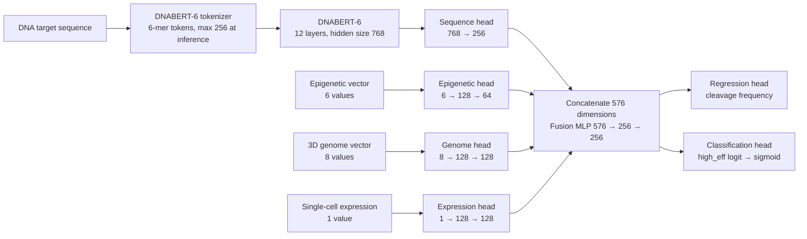

# AI-CRISPR Project

A research software project for estimating CRISPR target cleavage frequency and a dataset-defined high-efficiency class from DNA sequence and biological context. The repository contains a DNABERT-6 backbone, a multimodal PyTorch model, preprocessing and evaluation tools, a FastAPI service, and a React/Vite interface.

> **Current application mode:** The frontend exposes only **Missing Feature Demo** mode. It sends a DNA sequence and explicitly consents to the API zero-filling omitted biological modalities. The output is an exploratory model response, not a full multimodal result or an experimentally validated biological outcome.

## Problem and motivation

CRISPR guide/target sequence models do not capture all factors that may affect cleavage in cells. Chromatin state, genome organization, and gene expression can provide context, but those measurements are incomplete or incompatible across many records in this project. This codebase explores a multi-input architecture while making that data gap visible in its current application.

The project is not a clinical decision tool and does not establish causal biological relationships.

## Objectives

- Encode DNA target sequences with a pretrained DNABERT-6 transformer.
- Combine sequence and biological context in a multi-branch neural architecture.
- Train regression and classification heads against the dataset's recorded labels.
- Evaluate the existing checkpoint with reproducible held-out and exploratory leakage-filtered reports.
- Demonstrate application wiring without presenting missing measurements as real data.

## Features and current application capabilities

- **Frontend:** responsive React + TypeScript + Vite interface; the visible mode is fixed to Missing Feature Demo.
- **Consent and provenance:** submission requires explicit consent. The UI identifies epigenetic, 3D genome, and single-cell inputs as unavailable and zero-filled.
- **Prediction:** reports model-estimated cleavage frequency, probability of the dataset-defined high-efficiency class, and its 0.5-threshold classification.
- **Model status:** displays API readiness/device, architecture, DNABERT identifier, parameter count, checkpoint path, and checkpoint hash.
- **Backend:** FastAPI exposes `/health`, `/model-info`, and `/predict`. The backend retains `full_multimodal` schema and inference support for callers that have valid inputs; the current data pipeline does not provide all six epigenetic measurements for every record.
- **Research tooling:** preprocessing, training, evaluation, attribution, benchmark reporting, and audit scripts are included. Literature baseline values are references only; baseline implementations were not run head-to-head.

## System architecture



The **live frontend** supplies only the sequence. In Missing Feature Demo mode the API creates zero placeholders for the omitted modalities and returns their unavailable status. This path must not be described as full multimodal inference.

## Technologies

- Python, PyTorch, Hugging Face Transformers
- DNABERT-6 and its matching tokenizer
- NumPy, pandas, scikit-learn, SciPy
- FastAPI, Pydantic, Uvicorn
- React 18, TypeScript, Vite, Tailwind CSS, lucide-react
- Optional preprocessing/interpretability dependencies include Scanpy/AnnData, BigWig readers, Captum, SHAP, Matplotlib, and TensorBoard
- Docker Desktop with NVIDIA GPU support for the supplied CUDA image

The versions used by the Python project are recorded in `requirements.txt`; the API's additional requirements are in `backend/requirements.txt`; frontend dependencies and lockfile are in `frontend/`.

## DNABERT-6 backbone

The backbone identifier is `zhihan1996/DNA_bert_6`, pinned in `model/backbone.py` to revision `c56e67ea5827e0ddc67ef059addcf71569b1216e`. It is a BERT-base-style encoder with 12 layers and a 768-dimensional hidden representation. DNA is converted to overlapping 6-mers and tokenized with the matching DNABERT tokenizer; inference pads/truncates to 256 tokens, including special tokens.

The loader validates model weights, configuration, and tokenizer assets. It downloads the pinned snapshot into `models/dnabert-base/` when needed and refuses to substitute random weights. The large backbone weight file is intentionally excluded from Git. To fetch/check the cache inside the project Docker image:

```powershell
docker run --rm -it --gpus all `
  -v "E:\AI_CRISPR-Project:/workspace/AI_CRISPR-Project" `
  -w /workspace/AI_CRISPR-Project `
  ghcr.io/hetakshib/ai-crispr:cuda bash -lc "python model/backbone.py"
```

This runs the backbone smoke test and may download the pinned model if its complete weights are not already cached. Network access to Hugging Face is needed for the first download. The cache and download remain under the mounted E: project directory.

## Multimodal model architecture

The trained model retains four input branches:

| Branch | Input | Projection |
|---|---:|---:|
| DNA sequence | DNABERT-6 CLS embedding, 768 dimensions | 768 → 256 |
| Epigenetic features | 6 values in order: H3K4me3, H3K27ac, H3K27me3, H3K9me3, ATAC-seq, DNase-seq | 6 → 128 → 64 |
| 3D genome | 8 values: loop count, TAD distance, and six compartment indicators (A1, A2, B1, B2, B3, NA) | 8 → 128 → 128 |
| Single-cell expression | one log-normalized mean expression value | 1 → 128 → 128 |

The branch outputs concatenate to 576 dimensions. A fusion MLP maps 576 → 256 → 256. Two heads produce:

- **Regression:** one unconstrained scalar estimate of `cleavage_freq`.
- **Classification:** one logit for `high_eff`; sigmoid yields an estimated probability of that dataset-defined class. A threshold of 0.5 produces the displayed binary class.

The probability is **not** a probability of experimental editing success. The regression head is not constrained to nonnegative values, so a negative estimate can occur and should be interpreted as a model output rather than a physical frequency measurement.

## Training and checkpoint

`train.py` implements three stages: epochs 1–2 freeze DNABERT, epochs 3–6 unfreeze its top four blocks, and epochs 7–15 unfreeze the full backbone. It uses AdamW, warmup/cosine scheduling, gradient accumulation, mixed precision where supported, validation-based early stopping, checkpoint resume support, and optional SWA (not asserted here as used for this checkpoint). The recorded checkpoint configuration used CUDA, micro-batch size 2, accumulation steps 16 (effective batch 32), sequence length 256, and patience 3. This README update does not retrain the model.

The existing local checkpoint is `outputs/model_best.pt`. Its recorded SHA-256 is:

```text
a12654b360e959a3ee6b9eab47f7a463152dcf813a90ec1e84b9f7f6260b4558
```

The checkpoint is excluded from this Git repository by the output tensor/checkpoint ignore rules because model checkpoints are large binary artifacts. A clone must be given the matching checkpoint at `outputs/model_best.pt` separately before the API can load it. The repository does not include a checkpoint download URL.

## Dataset and preprocessing

The preprocessing source is `data/sequence/crisprSQL_extracted/100720.csv`. The saved cleaned metadata contains **25,535 rows** split into 20,428 training, 2,553 validation, and 2,554 test records. The saved split is a random row split (seed 42); the held-out validation/test split is stratified where possible. It is not grouped by guide, target locus, study, or biological sample.

`utils/preprocess.py` builds DNABERT token IDs and attention masks, feature tensors, labels, split indices, provenance metadata, and a training-only epigenetic scaler. The regression target is the source `cleavage_freq` annotation. `high_eff` is derived using a 75th-percentile threshold fitted on training labels (recorded threshold: 0.001862); it is not an independently measured outcome.

### Biological feature availability and caveats

- **DNA:** target sequences are tokenized with DNABERT-6. A valid sequence does not by itself establish an unseen guide or locus.
- **Epigenetics:** the pipeline records H3K27ac, H3K27me3, and H3K9me3 as unavailable; those channels are zero-filled. H3K4me3 has a CSV fallback with nonzero values in 1,861 rows. Where available, ATAC is populated from the same `epigen_dnase` field as DNase (493 rows), so it is a DNase proxy, not an independent ATAC measurement. No local BigWig files were present in the audited preprocessing run, and assay provenance is not independently validated.
- **3D genome:** loop, TAD, and compartment features use a GM12878 reference as a proxy across source cell lines. Assembly/species compatibility is not checked comprehensively; coordinates are missing for some records and the dataset contains heterogeneous genome labels.
- **Single-cell expression:** the feature is derived from a PBMC 10x atlas and matched by target gene name for 5,502 of 25,535 rows. Unmatched rows are zero placeholders; zero values are not separately masked, and PBMC expression may not represent the source experiment or cell type.
- **Normalization:** the recorded epigenetic scaler and high-efficiency threshold were fitted using training rows. Missing measurements and proxies still limit how those channels should be interpreted.

The current frontend avoids requesting fabricated values by using the explicit missing-feature demonstration mode. Backend full multimodal support remains available but requires valid inputs supplied by a caller; the API cannot establish that submitted measurements are biologically appropriate.

## Evaluation methodology and reported metrics

The standalone evaluator and training evaluator were compared using the same checkpoint, the full saved test split, and 256-token truncation. Their reported predictions and targets were identical; metric differences were negligible. The full test split contains 2,554 rows.

| Full test metric | Result |
|---|---:|
| RMSE | 0.108988 |
| Pearson R | 0.752398 |
| ROC-AUC | 0.916372 |
| PR-AUC | 0.814999 |
| F1 at probability threshold 0.5 | 0.695355 |
| Brier score | 0.118236 |

RMSE is the square root of mean squared error; Pearson R is correlation of regression outputs and targets; ROC-AUC uses sigmoid class probabilities; PR-AUC is trapezoidal area from the precision-recall curve; F1 thresholds probability at 0.5; Brier score is mean squared probability error.

### Exploratory sequence-filtered subset

A separate report excludes test target sequences that exactly match or are reverse complements of training target sequences. It retains **1,612 of 2,554** test rows after removing 940 exact and 2 reverse-complement matches. This is a filtered subset of the original random split, not a newly grouped or independent test.

| Filtered subset metric | Result |
|---|---:|
| RMSE | 0.116148 |
| Pearson R | 0.760455 |
| ROC-AUC | 0.921854 |
| PR-AUC | 0.822647 |
| F1 at probability threshold 0.5 | 0.670630 |
| Brier score | 0.118474 |

Neither set of metrics establishes independent generalization. The filtered metric changes must not be interpreted as proof of superiority or improved generalization; the subsets and their overlap structure differ.

## Leakage and scientific reporting caveats

The original data split is random by row. The scientific audits report:

- Exact target-sequence overlap between train and test, plus reverse-complement overlap; these motivated the exploratory filtered subset.
- The filtered subset still has **15 retained target intervals overlapping training intervals**. All **705 retained guide-target intervals with valid coordinates** exactly match training guide-target intervals. Target and guide-target intervals describe different loci and should not be conflated.
- Approximate sequence similarity remains common in a left-aligned, ungapped screening comparison against training sequences: 99.6% of retained rows reached at least 70% identity, 89.8% at least 80%, 67.4% at least 90%, and 59.7% at least 95%. This is a screening measure, not an alignment-aware assessment.
- Coordinates/assemblies are unavailable or inconsistent for some records. Stable biological sample, replicate, and experiment identifiers are insufficient to establish source independence; independence is **not verifiable**.

Therefore, neither the full test report nor the sequence-filtered report proves generalization to unseen guides, loci, genomic regions, studies, or experiments. Grouped retraining and evaluation by guide/locus/study will be needed for those claims. Attribution plots summarize model sensitivity on the evaluated inputs; they do not establish biological causation.

Benchmark tables compare the project’s metrics with literature-reported reference values. The baseline implementations were not independently run under the same split and protocol, so these are not reproduced head-to-head experiments and do not prove superiority.

## Missing Feature Demo

The current React interface provides only **Missing Feature Demo**. The user enters DNA and must explicitly consent. The request omits epigenetic, 3D genome, and single-cell fields, sets `mode` to `missing_feature_demo`, and sets `allow_missing_features` to `true`. The API zero-fills those omitted modalities and marks them unavailable in its response.

This is a sequence-only demonstration using a model whose architecture has additional branches. It is not full multimodal inference. Predictions are model estimates, not laboratory measurements; comparing them with source annotations is exploratory. The class probability refers to the dataset-defined `high_eff` label and is not an experimental-success probability.

## Project structure

```text
backend/                 FastAPI app, Pydantic schemas, service, mocked tests
frontend/                React + TypeScript + Vite + Tailwind app
model/                   DNABERT loader, multimodal architecture, losses
models/dnabert-base/      Local DNABERT config/tokenizer; large weights excluded
utils/preprocess.py       Feature extraction, split generation, provenance
scripts/                  Inference, smoke/data checks, dashboard/benchmark tools
train.py                  Training and checkpoint management
evaluate.py               Held-out evaluation and attribution pipeline
data/                     Source data and benchmark references (where present)
outputs/model_best.pt     Existing local trained checkpoint (not committed)
outputs/tensors/          Existing local tensor splits (not committed)
outputs/*audit/           Scientific, leakage, and genomic similarity reports
outputs/live_demo_samples/Sequence-only demo requests/results and reproduction helper
logs/                     Local logs and TensorBoard output
```

Generated tensors, the trained checkpoint, large DNABERT weights, logs, and backup artifacts are not included as Git deliverables. Keep the required checkpoint and data on the E: project directory and do not commit secrets or local environment files.

## Windows 11 + Docker Desktop GPU setup

Prerequisites: Docker Desktop configured for Linux containers, a working NVIDIA driver/GPU passthrough, and the existing image `ghcr.io/hetakshib/ai-crispr:cuda`. The project is mounted from E: so model files, source data, tensors, outputs, and logs remain in the project directory.

### Start the FastAPI backend

Run in PowerShell from any directory:

```powershell
docker run --rm -it --gpus all -p 8000:8000 `
  -v "E:\AI_CRISPR-Project:/workspace/AI_CRISPR-Project" `
  -w /workspace/AI_CRISPR-Project `
  ghcr.io/hetakshib/ai-crispr:cuda bash -lc "python -m pip install -r backend/requirements.txt && python -m uvicorn backend.app.main:app --host 0.0.0.0 --port 8000"
```

Wait for startup to load the local checkpoint and DNABERT cache. In a second PowerShell window, check readiness and open interactive API documentation:

```powershell
Invoke-RestMethod -Uri http://127.0.0.1:8000/health | ConvertTo-Json
Start-Process http://127.0.0.1:8000/docs
```

The health response reports the selected device; `/model-info` reports the architecture and checkpoint provenance. The local backend uses CUDA when available and reports startup failure if the checkpoint or DNABERT cache is incomplete.

## Start the frontend

Keep the backend running. In another PowerShell window:

```powershell
Set-Location E:\AI_CRISPR-Project\frontend
npm install
npm run dev
```

Open the application at **http://127.0.0.1:5173**. Vite proxies `/api` requests to `http://127.0.0.1:8000`. Set `VITE_BACKEND_URL` only if the backend is running on a different host or port.

## API endpoints and request example

- `GET /health` — API/model readiness and device.
- `GET /model-info` — architecture, backbone identifier, checkpoint path/hash, parameter count, device, and token length.
- `POST /predict` — validated prediction request.

A sequence-only Missing Feature Demo request (the sequence below is from the held-out test examples used for the live demo):

```json
{
  "sequence": "GTGATAAGTGGAATAGCACATGTGG",
  "mode": "missing_feature_demo",
  "allow_missing_features": true
}
```

The request intentionally omits epigenetic, genome, and single-cell values. Do not interpret the response as a full multimodal prediction.

Example response from the existing local checkpoint (trimmed only to show the fields relevant to this demo):

```json
{
  "input_mode": "missing_feature_demo",
  "predicted_cleavage_frequency": -0.007557338103652,
  "high_efficiency_probability": 0.0004999251686967909,
  "high_efficiency_prediction": false,
  "sequence_nucleotides": 25,
  "sequence_tokens_used": 22,
  "sequence_length_tokens": 256,
  "model": {
    "architecture": "MultimodalCRISPR (DNABERT-6 + epigenetic + 3D genome + single-cell)",
    "pretrained_backbone": "zhihan1996/DNA_bert_6",
    "checkpoint_path": "outputs/model_best.pt",
    "checkpoint_sha256": "a12654b360e959a3ee6b9eab47f7a463152dcf813a90ec1e84b9f7f6260b4558",
    "parameter_count": 89645378,
    "device": "cuda",
    "sequence_length_tokens": 256
  },
  "feature_availability": {
    "sequence": { "available": true, "provenance": "user sequence encoded with cached DNABERT-6 tokenizer" },
    "epigenetic": { "available": false, "provenance": "missing; zero placeholder, not measured" },
    "3d_genome": { "available": false, "provenance": "missing; zero placeholder, not measured" },
    "singlecell_expression": { "available": false, "provenance": "missing; zero placeholder, not measured" }
  },
  "warning": "Incomplete-feature demonstration: missing modalities were zero-filled with explicit consent; these are not biological measurements."
}
```

This is an actual illustrative response from the local demonstration run, not a claim of biological performance. The negative regression output illustrates that the model head is unconstrained.
## Limitations and future work

- Acquire and validate missing epigenetic assays; avoid treating a duplicated DNase proxy as independent ATAC/DNase evidence.
- Match 3D genome and expression references to the biological source, cell type, species, and assembly; preserve explicit per-sample availability masks.
- Obtain stable guide, target-locus, study, replicate, and experiment identifiers and evaluate with grouped splits; assess sequence similarity with an alignment-aware method.
- Validate calibration and probability meaning on an independent, appropriately grouped dataset.
- Run baseline implementations under a harmonized protocol before making comparative performance claims.
- Review attribution stability and biological plausibility; do not infer causation from feature attribution alone.

## Disclaimer

This repository is a research and software demonstration. Its predictions are model estimates based on the data and inputs provided. Missing modalities are zero-filled only in the explicitly consented demo mode. Neither the demo outputs nor the reported exploratory test metrics are experimentally validated outcomes, clinical recommendations, or proof of generalization to independent guides, loci, or experiments.
